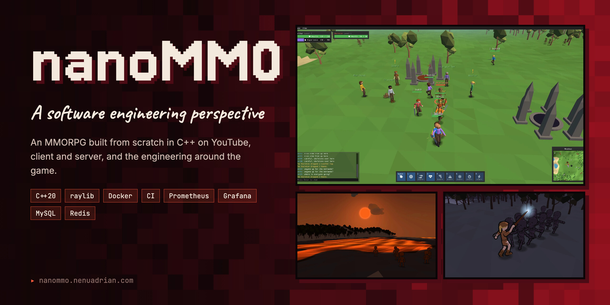
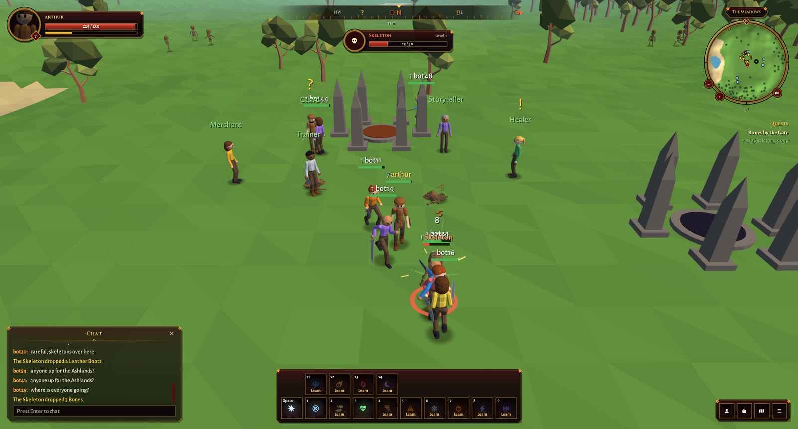
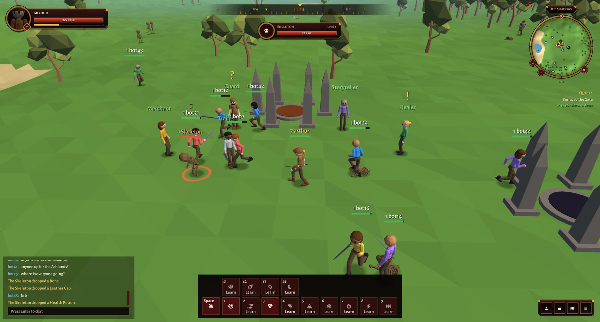

[](https://nanommo.nenuadrian.com)

# nanoMMO

[](https://github.com/nenuadrian/nanommo/actions/workflows/ci.yml) [](https://github.com/nenuadrian/nanommo/actions/workflows/dependencies.yml)

nanoMMO is a devlog where I build an MMO from scratch in C++, with features I'd like to see exist,
even if some might be impractical for most games, such as players creating their own skills. It's a
learning journey, with the software engineering and the hard parts out in the open, and not always
about the gameplay: a C++ server, a C++ client, and everything around them.

The episodes are [on YouTube](https://www.youtube.com/playlist?list=PLJcOiy0pkaG4), from the plan in
episode one. Each episode's code is a git tag (`ep001/end`, `ep002/end`, ...), and
[the series' website](https://nanommo.nenuadrian.com) has a page for each episode, with its code at
each step. The reasons behind the design are in [docs/decisions](docs/decisions/).





More screens, and every episode, are on [the series' website](https://nanommo.nenuadrian.com).

## Get started

[Getting started](docs/getting-started.md) goes from a clone to playing, a step at a time, on macOS
and Ubuntu 24.04, with what each error means. In short:

```bash
git clone https://github.com/nenuadrian/nanoMMO.git
cd nanoMMO
# What this machine is missing, and the command that installs it.
./doctor.sh
cmake --preset release
cmake --build --preset release
ctest --preset release
# MySQL, Redis, Consul and the saver, then the certificates, once.
docker compose up -d --build mysql redis consul saver
tls/certificates.sh
./build/bin/nanommo_login
```

Then the world and the game, each in a terminal of its own:

```bash
./build/bin/nanommo_server
./build/bin/nanommo_client
```

Or with only Docker installed:

```bash
# Build and run the tests on Ubuntu.
docker build --target test .
# Check the code style, and the translations.
docker build --target lint .
# The server image, if the tests pass.
docker build --target server -t nanommo-server .
# The login server's image.
docker build --target login -t nanommo-login .
# The saver's image.
docker build --target saver -t nanommo-saver .
# API docs in site/.
docker build --target docs --output site .
```

In Docker, the client's tests open their window on a virtual display from Xvfb, and render with
llvmpipe, Mesa's OpenGL driver that runs on the CPU. So they don't need a screen or a GPU.

The servers keep accounts in MySQL, and hand logins over through Redis. The game server saves the
players into Redis, and a saver takes them on to MySQL (see [Saving players](docs/saving.md)).
Each game server is a world, which registers with Consul, and the login server lists the worlds
from there (see [Worlds](docs/worlds.md)). Docker Compose runs MySQL, Redis, Consul and the saver, and
before them Flyway, which makes the tables from the migrations in `db/` (see
[Migrations](docs/saving.md#migrations)). The clients talk to the servers over TLS, with certificates from an
authority of our own, which `tls/certificates.sh` makes the first time (see [TLS](docs/accounts.md#tls)).
The client asks the login server on `localhost`, or on the host you give it, and how to play from
another computer is in [Getting started](docs/getting-started.md#6-play-from-another-computer).

`protocol/nanommo.proto` is the contract between the client and the servers. The build runs protoc on
it, and all sides use the C++ it generates. Items, monsters and NPCs are data (see
[Content](docs/content.md)).

## Docs

How each part of the game works is in `docs/`, a page each, which the
[API docs](https://nenuadrian.github.io/nanoMMO/) have in their menu too:

- [Getting started](docs/getting-started.md): from a clone to playing, on macOS and Ubuntu, and what each error means.
- [Gameplay](docs/gameplay.md): making a character, monsters, health and levels, fighting, skills,
  items and gold, quests, chat, guilds, trading, crafting, duels and guild wars, factions, the
  names over heads, and the help and the settings.
- [Content](docs/content.md): the items, monsters, NPCs, quests, skills, recipes and factions, as data the servers, the client and the bots read, checked as a graph in smollerGraph.
- [NPCs](docs/npcs.md): who stands where, the heralds, and the storyteller, which tells stories with mvGPT.
- [Graphics and sound](docs/graphics.md): the characters, the interface, the map, the sky, day and night, the weather, the music, the sound effects and the weather's, made from numbers, and the post-processing: bloom, cel shading and anti-aliasing.
- [Cinema](docs/cinema.md): filming the game frame by frame, in slow motion, with a stage of players and monsters, for the trailer.
- [The island](docs/island.md): the ground, the trees and the sea, made from a seed, and drawing them fast.
- [Worlds and lands](docs/worlds.md): the game servers, which Consul lists, and each world's lands and dungeons.
- [Networking](docs/networking.md): TCP and UDP when packets are lost, what each player gets, and what happens near them.
- [Accounts, logins and TLS](docs/accounts.md): the login server, the tokens, and TLS with an authority of our own.
- [Saving players and migrations](docs/saving.md): the players in Redis, the saver that takes them on to MySQL, and Flyway's migrations.
- [The website](docs/website.md): the Laravel website, with its rankings and accounts.
- [Monitoring, logs, traces and analytics](docs/monitoring.md): Prometheus and Grafana, the bots, alerts, logs in Loki, traces in Tempo, and analytics in ClickHouse.
- [Benchmarking and profiling](docs/benchmarking.md): the load test, flame graphs, Pyroscope and Tracy, and chaos experiments.
- [Reliability](docs/reliability.md): the objectives and their error budgets, the alerts on how fast those burn, what breaking things on purpose found, and [postmortems](docs/postmortems/README.md).
- [Deployment](docs/deployment.md): a server with Docker Compose, handing players over without downtime, and deploying on push.
- [The client in a browser](docs/web.md): the client built with Emscripten, drawing with WebGL 2 in a page, what differs there, playing offline, and online through the gateway.
- [Translations](docs/translations.md): the client in English and Romanian, gettext's PO files, plurals, the content's names, the servers' sentences as messages the client translates, pseudo-localisation, adding a language, and what stays English.
- [Code style and checks](docs/checks.md): clang-format and cpplint, the sanitizers, the fuzzers, clang-tidy and the coverage report.
- [Versions and dependencies](docs/releases.md): the game's version, which clients the login server lets in, releases, and keeping the libraries, images and packages up to date.
- [Decisions](docs/decisions/README.md): why the game is built the way it is, a short record for each choice that would be costly to undo, and what it costs us.
